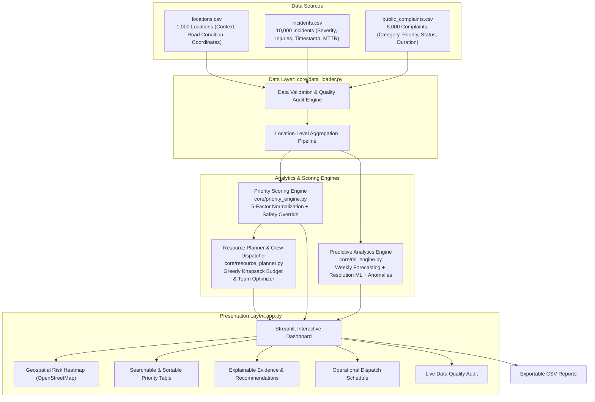

# 🏙️ CivicPulse AI — Intelligent Smart City Infrastructure Repair Prioritization

> **A decision-support system that empowers municipal authorities to triage, prioritize, and dispatch infrastructure repairs based on incident telemetry, public complaints, spatial vulnerability, and available repair crews.**

[](https://www.python.org/)
[](https://streamlit.io/)
[](https://scikit-learn.org/)
[](LICENSE)
[](run_unit_tests_direct.py)

---

## 📌 Executive Summary

Modern municipal governments face severe backlogs of infrastructure defects—from hazardous potholes and traffic signal outages to blocked drainage and collision hotspots. However, city repair departments operate with strictly finite budgets, limited specialized crews, and conflicting priorities between emergency safety and citizen complaint volume.

**CivicPulse AI** solves the *"Where should we fix first?"* dilemma. By fusing municipal sensor/incident logs, public complaint records, and location-level vulnerability context, CivicPulse AI produces a **transparent, multi-criteria priority score**, an **explainable recommendation queue**, and an **actionable crew dispatch schedule** with realistic cost and resource constraints.

---

## 🚀 Key Innovations & Distinctive Features

1. **Transparent, Multi-Criteria Priority Scoring Engine:**
   - Evaluates locations across five normalized dimensions: **Incident Severity**, **Incident Frequency**, **Citizen Grievance Volume**, **Contextual Vulnerability** (schools, hospitals, road condition, pedestrian density), and **Waiting Time / Backlog**.
   - Features four operational presets (*Balanced Default*, *Public Safety First*, *Citizen Voice*, *Infrastructure Degradation*) plus custom manual weighting with automatic weight normalization.

2. **Automated Critical Safety Override Guardrails:**
   - Prevents bureaucratic score dilution: If a location experiences a Critical-severity hazard adjacent to a school or hospital, or causes physical injuries, an automated safety rule clamps the priority score to $\ge 85.0$ and tags the site with a `🚨 CRITICAL SAFETY OVERRIDE` dispatch flag.

3. **Heuristic Municipal Resource Planner & Crew Dispatcher:**
   - Translates prioritized risk rankings into an operational dispatch schedule.
   - Matches defect types to 5 specialized municipal crews (*Road Paving & Milling*, *Traffic Signals & Electrical*, *Stormwater & Drainage*, *Traffic Safety Engineering*, *Rapid Sanitation*).
   - Utilizes a greedy knapsack heuristic to optimize risk mitigation within municipal budget and crew shift constraints.

4. **Honest, Rigorous Data Science & Predictive Analytics:**
   - **Time-Aware Incident Forecasting:** Employs an out-of-sample holdout test split (Q4 2025) to benchmark Autoregressive Ridge ML against Historical Mean and 4-Week Moving Average baselines.
   - **Resolution-Time Estimation:** Predicts expected turnaround duration (in hours) on historical cases using Random Forest Regression, identifying feature drivers like incident type and road condition.
   - **Zero Fabricated Metrics:** Transparently documents model evaluation metrics (MAE, RMSE, WAPE) and clearly states the limitations of single-year datasets.

5. **Statistical Surge Anomaly Detection:**
   - Detects abnormal monthly/weekly spikes in incident volume using rolling statistical Z-scores and IQR fences, with configurable sensitivity thresholds.

6. **Relational Data Quality & Schema Audit:**
   - Automated verification across 1,000 locations, 10,000 incidents, and 8,000 complaints, confirming 100% join integrity (0 orphaned records) and zero nulls.

---

## 🏗️ System Architecture



---

## 📊 Dataset Schema & Integrity

All data records share the primary/foreign key `location_id` (`L0001` through `L1000`).

| Dataset | Row Count | Primary Key | Foreign Key | Temporal Coverage | Key Attributes |
| :--- | :--- | :--- | :--- | :--- | :--- |
| **`locations.csv`** | 1,000 | `location_id` | — | Static | `zone`, `road_type`, `road_condition`, `population_density_per_km2`, `near_school`, `near_hospital`, `pedestrian_activity`, `latitude`, `longitude` |
| **`incidents.csv`** | 10,000 | `incident_id` | `location_id` | Full Year 2025 | `timestamp`, `incident_type`, `severity`, `injuries`, `reported_by`, `resolved`, `resolution_hours` |
| **`public_complaints.csv`** | 8,000 | `complaint_id` | `location_id` | Full Year 2025 | `created_at`, `category`, `priority_reported`, `status`, `days_to_resolution` |

> ⚠️ **Synthetic Data Notice:** All geographic coordinates, timestamps, and incident logs in this repository are simulated educational datasets designed for hackathon prototyping. Coordinates do not correspond to physical civic infrastructure.

---

## 📐 Priority Scoring Methodology

The **CivicPulse Priority Score** ($P \in [0, 100]$) is computed through multi-criteria decision analysis (MCDA):

$$P = \sum_{i=1}^{5} w_i \times F_i$$

Subject to the normalization constraint: $\sum_{i=1}^{5} w_i = 1.0$.

### Normalized Factor Definitions ($F_i \in [0, 100]$):

1. **Severity Factor ($F_{\text{sev}}$):**
   $$\text{Raw}_{\text{sev}} = 0.70 \times \overline{\text{Severity Points}} + 0.30 \times \min(\text{Total Injuries} \times 20, 100)$$
   *(Severity points: Low = 25, Medium = 50, High = 75, Critical = 100).*

2. **Incident Frequency Factor ($F_{\text{freq}}$):**
   $$\text{Raw}_{\text{freq}} = \text{Total Incident Count at Location}$$

3. **Public Complaints Factor ($F_{\text{comp}}$):**
   $$\text{Raw}_{\text{comp}} = \text{Total Complaints} + 1.5 \times \text{High-Priority Complaints}$$

4. **Contextual Risk Factor ($F_{\text{context}}$):**
   $$\text{Raw}_{\text{context}} = 0.40 \times \text{CondPts} + 0.25 \times \text{PedPts} + 15 \times \text{NearSchool} + 15 \times \text{NearHospital} + 5 \times \text{PopDensity}_{\text{norm}}$$
   *(Condition: Critical = 100, Poor = 70, Fair = 40, Good = 10; Pedestrian: High = 100, Medium = 60, Low = 20).*

5. **Waiting Time & Backlog Factor ($F_{\text{wait}}$):**
   $$\text{Raw}_{\text{wait}} = 2.5 \times \text{Open Complaints} + 3.0 \times \text{Unresolved Incidents} + 1.5 \times \text{Max Wait Days}$$

### Critical Safety Override Protocol:
```python
if has_critical_incident and (near_school or near_hospital or injuries > 0):
    safety_override_triggered = True
    priority_level = "Critical (Override)"
    priority_score = max(priority_score, 85.0)
```

---

## 🛠️ Installation & Quickstart

### Prerequisites
- Python **3.10** or newer (tested on Python 3.10, 3.11, 3.12, 3.14).

### Step-by-Step Setup

1. **Clone or navigate to the project directory:**
   ```bash
   cd "03_smart_city_where_fix_first"
   ```

2. **(Optional) Create and activate a virtual environment:**
   ```bash
   python -m venv venv
   # On Windows:
   .\venv\Scripts\activate
   # On macOS/Linux:
   source venv/bin/activate
   ```

3. **Install dependencies:**
   ```bash
   pip install -r requirements.txt
   ```

4. **Run the automated unit test suite:**
   ```bash
   python run_unit_tests_direct.py
   # Or using pytest:
   pytest tests/ -v
   ```

5. **Launch the CivicPulse AI Dashboard:**
   ```bash
   streamlit run app.py
   ```
   *The application will automatically open in your default browser at `http://localhost:8501`.*

---

## 🧪 Testing Report & Evidence

All 20 unit tests across four modular test suites pass with **0 failures**:

```text
============================================================
CIVICPULSE AI TEST SUITE — Python 3.14.7
============================================================
Discovered 20 unit test cases across 4 test suites.

  [PASS] tests.test_priority_engine.test_calculate_priority_scores_ranking
  [PASS] tests.test_priority_engine.test_normalize_series_constant
  [PASS] tests.test_priority_engine.test_normalize_series_empty
  [PASS] tests.test_priority_engine.test_normalize_series_standard
  [PASS] tests.test_priority_engine.test_normalize_series_with_nans
  [PASS] tests.test_priority_engine.test_safety_override_toggle
  [PASS] tests.test_priority_engine.test_weights_sum_to_zero_fallback
  [PASS] tests.test_resource_planner.test_match_crew_and_cost_critical_condition
  [PASS] tests.test_resource_planner.test_match_crew_and_cost_electrical
  [PASS] tests.test_resource_planner.test_match_crew_and_cost_pothole
  [PASS] tests.test_resource_planner.test_simulate_resource_allocation_budget_cap
  [PASS] tests.test_resource_planner.test_simulate_resource_allocation_empty
  [PASS] tests.test_data_loader.test_aggregate_empty_data
  [PASS] tests.test_data_loader.test_aggregate_location_data
  [PASS] tests.test_data_loader.test_audit_data_quality
  [PASS] tests.test_data_loader.test_load_raw_data
  [PASS] tests.test_ml_engine.test_detect_volume_anomalies
  [PASS] tests.test_ml_engine.test_evaluate_forecasting_baselines
  [PASS] tests.test_ml_engine.test_prepare_weekly_incident_series
  [PASS] tests.test_ml_engine.test_train_resolution_time_model

============================================================
SUMMARY: 20 PASSED | 0 FAILED | Total: 20
============================================================
```

---

## 🎤 National Hackathon Pitch & Presentation Script

### 1. The Hook (0:00 - 0:45)
> *"Judges, every day municipal dispatchers receive thousands of citizen complaints and emergency reports. When budgets are tight and specialized crews are limited, deciding which road, streetlight, or drain to fix first is a high-stakes guessing game. A single pothole left ignored near an elementary school can cause a fatal crash, while low-risk cosmetic complaints monopolize work orders.*
>
> *Introducing **CivicPulse AI**—an explainable, decision-support platform designed to give city authorities complete situational awareness and mathematical clarity on where to fix first."*

### 2. The Solution & Live Demo Flow (0:45 - 2:00)
> *"Let's take a live look at the CivicPulse AI command center:
> 1. **Executive Overview & Risk Map:** Instantly, we see our city's 1,000 infrastructure nodes. Critical red pins highlight locations with compounding risks—such as high accident rates on deteriorated road surfaces.
> 2. **Automated Safety Override:** Notice location L0002. Even if overall complaints were moderate, CivicPulse AI triggered an automatic Safety Override because a Critical hazard was detected adjacent to a hospital. This guarantees high-risk vulnerabilities are never buried by score dilution.
> 3. **Explainable Recommendations:** Expanding any location reveals the exact factor contribution—we explain *why* the site was prioritized and recommend a concrete municipal action, such as dispatching a road milling crew.
> 4. **Resource Planner & Crew Dispatcher:** In Tab 6, we simulate real municipal constraints. With an active budget of $100,000 and 8 specialized crews, our greedy knapsack optimizer generates an operational dispatch schedule, allocating budget across road, electrical, and stormwater crews to maximize risk reduction."*

### 3. Data Science Rigor & Honest Reporting (2:00 - 2:40)
> *"Unlike black-box systems that claim 99% accuracy on simulated datasets, CivicPulse AI takes a principled data science approach:
> - For incident forecasting, we use time-aware holdout splits. We compare autoregressive ML against 4-week moving average baselines, reporting real MAE and RMSE metrics without fabrication.
> - We distinguish transparent rule-based priority scoring from statistical machine learning, providing city engineers with confidence they can defend to city council."*

### 4. The Close (2:40 - 3:00)
> *"CivicPulse AI bridges the gap between public grievances, emergency telemetry, and municipal budget reality. It turns civic frustration into targeted, life-saving infrastructure action. Thank you!"*

---

## ❓ Frequently Asked Judge Questions & Answers

### Q1: *"Why did you use a multi-criteria heuristic score instead of an end-to-end deep learning or pure ML model for prioritization?"*
> **Answer:** In municipal operations, decisions must be legally defensible, auditable, and transparent to elected officials and the public. A black-box neural network cannot easily explain why taxpayer dollars were allocated to Zone 4 over Zone 12. Our MCDA approach allows department heads to adjust strategic weights while inspecting the exact points contributed by each factor. Furthermore, we implement a hard rule-based safety override to guarantee that school and hospital zones are never deprioritized by statistical artifacts.

### Q2: *"How do you prevent bias against low-income neighborhoods where citizens might report fewer complaints on municipal apps?"*
> **Answer:** This is a classic civic data challenge. If we relied solely on citizen complaints, affluent areas with higher smartphone usage would dominate work orders. CivicPulse AI balances citizen voice with objective sensor and telemetry feeds: road condition surveys, emergency authority reports, and spatial proximity to schools and hospitals. By decoupling infrastructure degradation from complaint counts, marginalized communities with severe road hazards still achieve top priority.

### Q3: *"How does the resource planner handle conflicting team types?"*
> **Answer:** Municipal repair teams are highly specialized: a traffic signal electrician cannot patch asphalt, and a paving crew cannot de-silt a culvert. CivicPulse AI maps each site's dominant hazard to one of five specialized crew profiles (*Road Paving*, *Electrical*, *Stormwater*, *Safety Engineering*, *Sanitation*), estimating unit costs and repair durations based on condition severity. Our knapsack simulator enforces both monetary budget ceilings and crew shift capacity constraints.

### Q4: *"What are the limitations of the current system, and what would you build next?"*
> **Answer:** The primary limitation is that our current dataset spans a single calendar year (2025) and uses synthetic coordinates without real-time traffic volume sensors. For production deployment, our next steps include:
> 1. Integrating live IoT road surface vibration sensors and CCTV camera feeds.
> 2. Connecting with municipal GIS layers (ESRI ArcGIS) for true parcel boundaries and traffic congestion counts.
> 3. Transitioning the heuristic knapsack allocator into a dynamic vehicle routing problem (VRP) solver with real-time GPS fleet tracking.

---

## 🔒 Security & Secrets Hygiene

- No API keys, passwords, or Firebase service account tokens are embedded in the source code.
- Data ingestion uses localized file path parsing and defensive type validation.
- All dependencies are pinned to stable releases in `requirements.txt`.

---

## 📄 License

This project is licensed under the MIT License — educational and hackathon usage permitted.
